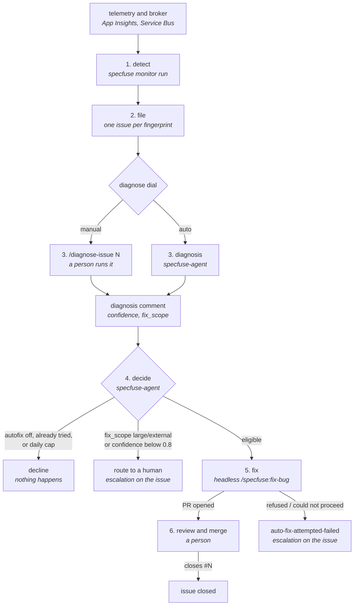

# From finding to fix

How a failure in a deployed component becomes a GitHub issue, a diagnosis, and
— if you let it — a pull request that fixes it. This page follows one failure
through every stage, names the process that runs each stage and the dial that
controls it, and marks the point where each stage stops for a person.

It describes what ships today. Behaviour that is planned rather than shipped is
labelled **planned** with the feature or issue that owns it.

The schema these stages read is [`monitoring-schema.md`](monitoring-schema.md);
where the harvest runs is [`monitoring-runners.md`](monitoring-runners.md).

## 1. Detect — `specfuse monitor run`

**What runs it.** `specfuse monitor run` (also installed as `specfuse-monitor
run`), from `specfuse/monitor/cli.py`. You run it by hand, from cron, or from
the shipped GitHub Actions template — see
[`monitoring-runners.md`](monitoring-runners.md). The loop schedules nothing
itself.

**What it reads.** `.specfuse/monitoring.yml`: each component's checks
(`error-logs`, `http-5xx`, `http-status-regression`, `dlq`, `queue-stalled`,
`heartbeat`, `invariant`), each environment's telemetry and broker bindings.
Event-history checks read only what arrived since the previous run (the
watermark in `.specfuse/monitor-watermarks/<env>.json`, or the last 24 hours on
a first run).

**What it produces.** One **finding** per observed failure, identified by a
**fingerprint** (`specfuse/monitor/fingerprint.py`) derived from the component,
the check type and a normalised failure signature, so the same failure seen
twice has the same fingerprint. A check that errors is reported in the run
summary and does not stop the others; the watermark is then left in place so
the window is retried.

**Where it stops for you.** It does not. `--dry-run` prints what it would file
and touches nothing.

## 2. File — one GitHub issue per fingerprint

`specfuse/monitor/issues.py` turns each finding into issue state:

- **A new fingerprint** opens an issue labelled `monitoring-finding`. The body
  carries a hidden `specfuse:finding` marker holding the fingerprint, plus the
  component, check type, failure class and signature, any target (subscription,
  schedule), and the observed text.
- **A fingerprint that already has an open issue** bumps that issue's
  occurrence count — at most once every 6 hours per issue.
- **The same fingerprint several times in one run** is filed once; the summary
  reports the extra rows as repeats.
- **A fingerprint whose issue was closed** is filed as a new issue today: the
  lookup reads open issues only. **Planned** (FEAT-2026-0204): reopen the closed
  issue with a comment instead, so its history and diagnosis stay in one place.

The monitor never closes an issue. Closing is a human decision, so a fault that
goes quiet for a while keeps its evidence.

**What a person sees.** An issue per distinct failure, under the
`monitoring-finding` label.

## 3. Diagnose — the `diagnose` dial

A **diagnosis** is one comment on the finding issue, rendered by
`specfuse/monitor/diagnosis.py`, carrying a root cause, the evidence trail, a
candidate fix, a `confidence` between 0 and 1, and a `fix_scope` of `small`,
`large` or `external`. It does not fix anything; it is what the next stage
reads.

- **`diagnose: manual`.** A person runs `/diagnose-issue <N>` in Claude Code.
  The skill reads the finding and the component's source, then posts the
  comment.
- **`diagnose: auto`.** `specfuse-agent` diagnoses for you: its findings-diagnose
  provider (`specfuse/agent/providers/findings_diagnose.py`) offers one item per
  open finding whose component is `auto` and that has no diagnosis yet, runs a
  headless analysis session, and posts the same comment.

Either way it is **one diagnosis per issue**: an issue that already carries a
parseable diagnosis is skipped. A session whose output cannot be parsed posts
nothing and escalates on the issue instead.

**Where it stops for you.** Under `manual`, here. Under `auto`, only when the
analysis output is unusable.

## 4. Decide — the `autofix` dial

Also run by `specfuse-agent`: its findings-autofix provider
(`specfuse/agent/providers/findings_autofix.py`) offers an item for each open
finding that already has a diagnosis. The decision itself is
`specfuse/monitor/autofix.py`, applied in this order:

1. `autofix` is not `"on"` for the component — **decline**.
2. `fix_scope` is `large` or `external` — **route to a human**.
3. `confidence` is below **0.8** — **route to a human**.
4. This fingerprint has already had an automated attempt — **decline**. One try
   per fingerprint.
5. **5** automated attempts have already fired in the last 24 hours — **decline**.
6. Otherwise — **fire**.

The threshold, the cap and the one-try rule are constants in code, not config
values, so they cannot be tuned away from the config file. Anything the
predicate cannot read (a diagnosis that does not parse, a component missing
from the config) declines; it never fires on a guess.

**What a person sees.** A decline is silent — the predicate working, not a
failure. A route-to-human raises an escalation for the finding (a
`needs-human` issue or annotation) naming the rule that fired.

## 5. Fix — a headless `/specfuse:fix-bug`

When the decision is **fire**, `specfuse/monitor/autofix_run.py` records the
attempt on the issue *before* launching, then starts a headless
`/specfuse:fix-bug` session (`specfuse/monitor/autofix_invoke.py`): the same
bug workflow a person runs — a failing test first, the fix, the project's
gates, one branch and one pull request that says `closes #N`.

If the session cannot finish (the fix is feature-sized, no reproducing test can
be written, a gate fails), it ends with a named outcome, the issue gets the
`auto-fix-attempted-failed` label and an escalation comment, and the one-try
rule keeps it from being retried automatically.

**The autofix path never merges.** The session is instructed it must not merge,
enable auto-merge or push to a protected branch, and `autofix_run.py` has no
merge step. The bug lane's auto-merge (below) only runs on issues the bug lane
itself selected, which are triaged bugs, so as of this version a pull request
opened by autofix waits for a person.

## 6. Review and merge

You review and merge the pull request. Its `closes #N` closes the finding issue.

If the same fingerprint fires again after the fix ships, today that files a
new issue (see stage 2). **Planned** (FEAT-2026-0204): the closed issue reopens
with the new sighting, which is the regression signal you want.

## What must be scheduled

Two separate processes drive this flow, and both must run for it to move on its
own:

- **`specfuse monitor run`** does stages 1 and 2. It does not diagnose and does
  not fix, whatever the dials say.
- **`specfuse-agent`** does stages 3 (`diagnose: auto`) and 4–5
  (`autofix: "on"`). If nothing runs it, `diagnose: auto` has no effect: findings
  are filed and stay undiagnosed.

`specfuse-agent` is a conductor for every automated lane in the repository, not
only monitoring — it also advances queued features, fixes triaged bugs and
triages issues, according to `.specfuse/agent-policy.yml`. Read
[`../lifecycles.md`](../lifecycles.md#3-the-autonomous-lifecycle) before
scheduling it, and set its budgets. Within one run it picks work by tier:
answered escalations first, then bugs and autofixes together (tier 0 when
`rules.bugs.preempt` is on, otherwise after queued features), then diagnoses,
then triage. Autofixes count against `budgets.max_open_prs` like bug fixes.

Whether `specfuse monitor run` should trigger diagnosis itself is open
(specfuse/loop#3488). Running inside the cluster is **planned** (FEAT-2026-0043).

## Turning the dials up

Start every component at `diagnose: manual`, `autofix: "off"` and move one dial
at a time:

1. **`manual` / `"off"`.** Findings are filed. Run `/diagnose-issue` on a few
   and read the diagnoses: is the root cause right, does the evidence hold up,
   is the `confidence` honest?
2. **`diagnose: auto`.** Once manual diagnoses read well, let `specfuse-agent`
   write them. Keep reading them; this is the evidence the next step depends on.
3. **`autofix: "on"`.** Once diagnoses at `confidence` ≥ 0.8 with
   `fix_scope: small` are reliably right, let them fire. Review the pull
   requests as you would any other.

Each step is reversible by setting the dial back.

## The human-issue path, for comparison

Issues people write take a different route to the same fix workflow:

1. **Triage** (`/triage-issues`, or `specfuse-agent` when `rules.triage.auto` is
   on) gives the issue a category (`bug`, `feature`, `duplicate`, `question`,
   `wontfix`) and a severity.
2. **The bug lane** takes triaged bugs at or above `rules.bugs.min_severity`,
   runs the same headless `/fix-bug`, and — when `rules.bugs.automerge` is on and
   every merge guardrail passes — merges the pull request itself.

**Findings skip triage on purpose.** `list_untriaged` flags any issue carrying a
finding marker as already structured (`specfuse/loop/triage.py`), and the triage
provider skips it (`specfuse/agent/providers/triage.py`): the monitor already
knows a finding is a defect, and the diagnosis and autofix stages gate it on
stronger evidence than a category. As a result a finding has no triage
category and no severity, and the bug lane does not pick it up unless a person
labels it a bug. **Planned** (FEAT-2026-0205): a severity on the diagnosis, so
findings can be prioritised without going through triage.

| | Finding | Human-written issue |
| --- | --- | --- |
| Enters by | `specfuse monitor run` | a person opening an issue |
| Classified by | the check that found it | triage |
| Gated by | diagnosis `confidence` and `fix_scope` (`autofix.py`) | triage category and severity (`min_severity`) |
| Fixed by | headless `/specfuse:fix-bug` | headless `/fix-bug` (bug lane) |
| Merged by | a person | the bug lane, when `rules.bugs.automerge` is on |
